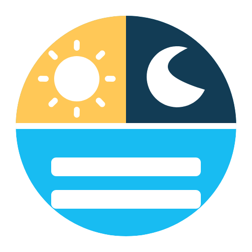

# CCA_zaluzie

Home Assistant custom integration for automated blinds and shutters, with one automation and side-panel row per cover, preserving applicable behavior of Cover Control Automation (CCA) and the dashboard interaction model of Svetlo v tme / Entity Controller.

## Project status

The installable integration is version **2026.12.5**, for Home Assistant
**2026.9.0+**. The minimum is 2026.9; CI checks both the minimum release line
and the current release. Download the published asset from
[Releases](https://github.com/denkz0ne/CCA_zaluzie/releases).

## Installation

1. In HACS, add `https://github.com/denkz0ne/CCA_zaluzie` as a custom repository,
   category **Integration**, and download CCA Žalúzie.
2. Restart Home Assistant manually after installation.
3. Open Settings → Devices & services → Add integration → **CCA Žalúzie**.
4. Select one cover, give it a name and configure its morning/evening times.
5. Open **CCA Žalúzie** in the sidebar for controls, history and grouped settings.
   Add each additional cover as its own independent integration entry.

Manual installation: extract the release asset `cca_zaluzie.zip` into
`config/custom_components/cca_zaluzie/`. `manifest.json` must be directly inside
that directory. Then follow steps 2–5 above.

## Operation

The panel distinguishes measured position, desired target, active condition,
movement inhibition and pending events. Configuration drafts belong to their
selected cover and survive section/cover switching; Save commits to HA and
Discard restores the saved settings. Native options also expose advanced HA
condition/action editors.

Drag the small grip on the top edge of a cover card to change its order.
The grip also supports arrow keys, Home and End. Ctrl/Cmd-click or long-press
on a touch screen to edit common settings for several covers. Only
explicitly changed fields are saved; individual names, sensors, physical positions
and action editors remain protected. Changes made elsewhere are detected before saving.

The overview calculates the next possible movement from the current settings and
solar position, and compares current inputs with the values in that scenario.
Unknown future inputs remain clearly marked as assumptions. History shows
measured positions with unavailable intervals left as gaps; simulated/estimated
positions are distinct. Simulation controls are in settings.

Morning/evening use Early/Late windows, solar height and workday/free-day rules.
Legacy calendar and brightness schedule fields are migrated but no longer control
day/night. Shading moves the whole cover vertically and keeps its configured
weather selection and optional lux/temperature inputs. Contact protection,
ventilation, resident state, manual handling, Force and pause remain separate
layers. Issue #13 mechanics and their safety rules are documented in
[Control engine](docs/CONTROL_ENGINE.md). If several Force requests are active,
the most recently activated wins, except that an enabled passage lockout blocks
Force-close. Pause inhibits all movement dispatch, including Force.

Startup and unavailable-device recovery are **off by default**. Explicit
**Prepočítať cieľ** allows reconciliation; settings can enable automatic recovery.
Unknown required inputs do not authorize movement. For devices without position
feedback, select the calibrated drive-time source; partial timed movement needs
an end-stop reset first. The UI labels calculated positions as estimates.

By default, CCA automatically selects reliable live position feedback: it prefers
Home Assistant's `current_position` and falls back to `position`. If both valid
values conflict beyond the configured tolerance, or neither is available, it
shows the source selector and blocks movement until a usable source is chosen.
Custom sensors and calibrated drive time are always explicit choices; estimated
travel time is never treated as measured position.

**Reset polohy** closes fully, waits for confirmed arrival (or the explicitly
configured full drive time), dwells exactly **60 seconds**, then sends STOP.
The reset owns motor dispatch. Cancellation/unload attempts STOP; interruption,
unavailability or service failure produces a visible non-success state. It never
silently restarts after HA restarts.

## Documentation and checks

- [Panel operation, ordering and bulk editing](docs/PANEL.md)
- [Feature mapping and implementation decisions](docs/FEATURE_MATRIX.md)
- [Current control-engine behavior and migration](docs/CONTROL_ENGINE.md)
- [Integration icon and HA brand assets](docs/BRANDING.md)
- [Behavior reference](docs/CCA_REFERENCE.md)
- [Architecture and release acceptance](docs/superpowers/specs/2026-10-11-integration-design.md)
- [Attribution](ATTRIBUTION.md) · [Changelog](CHANGELOG.md)
- [GitHub Actions](https://github.com/denkz0ne/CCA_zaluzie/actions)

Pure behavior tests can run on Python 3.12+. Real HA lifecycle/API tests run on
Linux with Python 3.14 and `requirements_test.txt`; use `python -m pytest -q`.
Browser tests use `npm ci`, `npx playwright install chromium`, `npm test`.
Their isolated fixture renders the production panel and never connects to motors.

## Start here

- [Implementation brief](docs/INTEGRATION_BRIEF.md) — user intent, UI model, proposed runtime architecture and delivery approach.
- [CCA behavior reference](docs/CCA_REFERENCE.md) — researched CCA behavior, state mechanics, feature inventory and upstream snapshot.
- [Latest interactive UI prototype](docs/ui/CCA_zaluzie_UI.html) — overview and per-cover configuration.
- [UI layout requirements](docs/ui/README.md)
- [Agent instructions](AGENTS.md)

## References

- [CCA upstream repository](https://github.com/hvorragend/ha-blueprints)
- [Current CCA blueprint source](https://github.com/hvorragend/ha-blueprints/blob/main/blueprints/automation/cover_control_automation.yaml)
- [Entity Controller](https://github.com/danobot/entity-controller)

