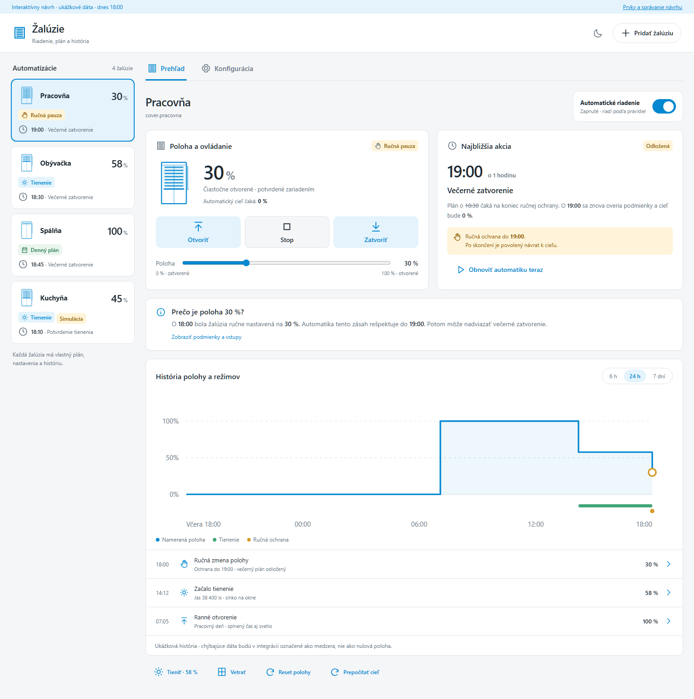
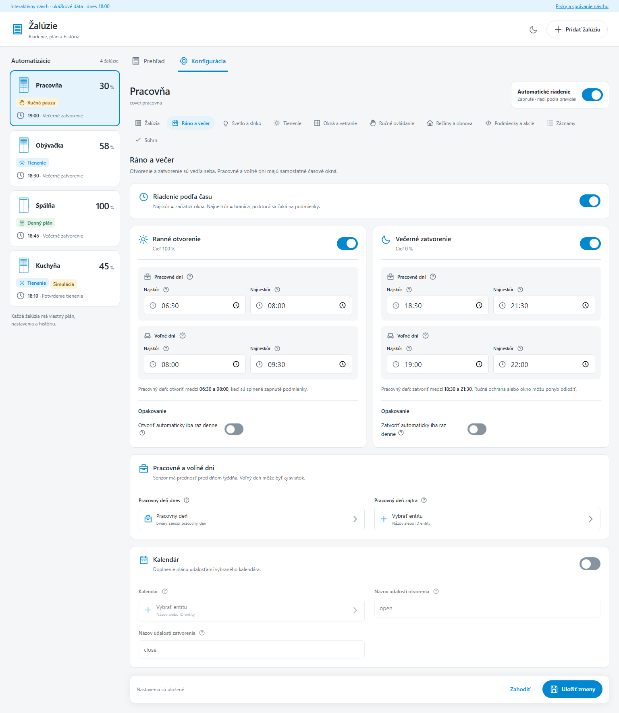

# Návrh kompletného redizajnu CCA Žalúzie

**Stav: návrh na posúdenie, bez úpravy produkčnej integrácie.** 15. október 2026.
Východisko: verzia 2026.11.1, commit `0e5f2ccc40edb7bf4abff6ef1cf66d18b2665247`.

[Otvoriť samostatný interaktívny HTML mockup](CCA_zaluzie_redesign.html) ·
[Prehľad](overview.png) · [Časový plán](schedule.png) ·
[Mobil](mobile.png) · [Tmavá téma](dark.png)

HTML stiahni a otvor samostatne, prípadne ho otvor cez lokálny náhľad.
GitHub zdrojový HTML súbor priamo nevykresľuje. Mockup je samostatný, bez
externých závislostí, prihlasovania alebo spojenia s Home Assistantom.
Všetky údaje a reakcie motorov sú označené ukážkové dáta. Uloženie platí iba
v pamäti tejto stránky; obnovenie vráti pôvodnú ukážku.

## Výsledok, ktorý má používateľ vidieť

Po otvorení panelu má človek bez rozklikávania vedieť:

1. ktorú žalúziu ovláda a aká je jej potvrdená poloha;
2. či ju riadi plán, tienenie, ručná ochrana, pauza alebo simulácia;
3. čo má nasledovať, kedy a prípadne prečo to čaká;
4. prečo je aktuálna poloha taká, aká je;
5. kde jedným dotykom žalúziu otvoriť, zastaviť alebo zatvoriť.

## Čo je dnes overené v zdroji

- Zoznam používa malé symboly, ID entity a jeden spojený stavový riadok.
  Aktualizácie ho prepisujú cez `innerHTML`; obnova spojenia znovu zostavuje
  mapu controllerov. Používateľ hlási preskočenie výberu, jeho presná príčina
  ešte nie je reprodukovaná. Toto zistenie samo osebe nie je dôkaz príčiny.
- `decision.next_at` je čas najbližšieho interného vyhodnotenia. Panel ho
  označuje všeobecne ako časovú hranicu alebo zmenu senzora. Nie je to
  dostatočný údaj pre názov a čas konkrétneho motorového povelu.
- Simulácia má ovládanie v prehľade. Predikcia sa v prehľade automaticky načítava.
- Po uložení sa `_notice` nastaví, ale samostatný časovač ho neskryje.
- Nastavenia sa generujú podľa základného typu poľa. Entity sú obyčajný vstup
  s `datalist`; súhrn vypisuje prakticky všetky polia.
- Platná mechanika: koniec ručnej ochrany **nemusí spôsobiť pohyb**.
  Rozhoduje `manual_return`; pri vypnutí vzniká držanie aktuálneho stavu.

Zdroj: `custom_components/cca_zaluzie/frontend/cca-zaluzie-panel.js`,
`controller.py`, `engine.py` a `config.py` v uvedenom východiskovom commite.

## Vizuálny jazyk a prvky Home Assistanta

Ploché plochy, tenké oddeľovače, primerané zaoblenie, primárna farba z HA témy,
čitateľné neutrálne texty. Modrá označuje aktívnu voľbu, jantárová ručnú ochranu,
čakanie alebo simuláciu. Stav je vždy pomenovaný, nespolieha sa iba na farbu.
Bez gradientov, dekoratívnych grafov či duplicitných náhľadov.

Prvky sú overené v oficiálnom HA frontend tagu `20260930.3`, ktorý používa
existujúca CI pre HA 2026.10.1. Produkčná implementácia musí overiť aj podporu
minimálnej verzie HA 2026.9. Standalone mockup má vizuálne a funkčné HTML/CSS
ekvivalenty; nenačítava ani nepredstiera skutočný HA runtime.

| Účel | Produkčný prvok / pravidlo |
| --- | --- |
| Hlavné zapnutie / vypnutie | [`ha-switch`](https://github.com/home-assistant/frontend/blob/20260930.3/src/components/ha-switch.ts), veľký cieľ dotyku a jasný textový stav |
| Povely a bežné tlačidlá | [`ha-button`](https://github.com/home-assistant/frontend/blob/20260930.3/src/components/ha-button.ts), HA ikony, viditeľný stav prebiehajúceho povelu |
| Poloha / percentá | [`ha-slider`](https://github.com/home-assistant/frontend/blob/20260930.3/src/components/ha-slider.ts) + synchronizovaná presná hodnota a jednotka |
| Denný čas | [`ha-time-input`](https://github.com/home-assistant/frontend/blob/20260930.3/src/components/ha-time-input.ts), lokálne zobrazenie hodín/minút podľa HA |
| Trvanie, výdrž, oneskorenie | [`ha-duration-input`](https://github.com/home-assistant/frontend/blob/20260930.3/src/components/ha-duration-input.ts), zrozumiteľné sekundy/minúty/hodiny |
| Entita | [`ha-entity-picker`](https://github.com/home-assistant/frontend/blob/20260930.3/src/components/entity/ha-entity-picker.ts), fulltext názvu aj ID, ikona, príslušný filter domény |
| Podmienky, akcie a výbery | [`ha-selector`](https://github.com/home-assistant/frontend/blob/20260930.3/src/components/ha-selector/ha-selector.ts), natívne vizuálne editory |

Číselné prahy používajú presný číselný vstup s jednotkou, nie univerzálny
posuvník. Rozsahy azimutu/výšky slnka zostávajú párovými hranicami s označeným
smerom. Viacnásobné voľby sú pomenované možnosti alebo checkboxy.

## Trvalý zoznam automatizácií

- Jedna žalúzia = jeden samostatný riadok/karta. Zostáva viditeľný pri nastaveniach.
- Ikona so zobrazenou výškou, výrazný názov a veľká potvrdená poloha.
- Samostatný odznak režimu; pod ním názov a čas ďalšej akcie.
- Výrazný rám a podfarbenie vybranej položky, dostupné aj cez `aria-pressed`.
- `entry_id` je identita výberu. Bežná aktualizácia, zmena poradia, návrat
  dostupnosti alebo reconnect nesmú zmeniť výber, scroll ani rozpracovaný návrh.
- Pri skutočnom odstránení vybratej položky sa zvolí deterministický sused
  a používateľ dostane krátke vysvetlenie. Pri dočasnej nedostupnosti zostáva výber.
- Na mobile sa zoznam zmení na lokálne posúvateľný pás. Posúvanie zoznamu
  nesmie spôsobiť horizontálny overflow celej stránky.

## Prehľad: ovládanie, príčina, plán a história

### Poloha a ručné ovládanie

Výrazné merané percento, zodpovedajúci obrázok žalúzie a oddelený cieľ.
Otvoriť / STOP / zatvoriť zostávajú vedľa seba, s ikonou, veľkým dotykovým
cieľom a stavom otvárania/zatvárania. STOP je dostupný aj počas pohybu.
Posuvník ručnej polohy má presnú hodnotu, koncové popisy a rovnaké ochrany
ako existujúci motorový gateway. Odhad a simulovaná poloha sa nesmú vydávať
za potvrdenie zo zariadenia. Neznáma poloha sa zobrazí ako neznáma.

Globálne automatické riadenie je výrazný prepínač so stavom. Zmena tejto
prevádzkovej voľby sa nesmie pomýliť s neuloženým formulárovým návrhom.
Pomocné povely (tienenie, vetranie, reset, prepočet) sú podriadené hlavnej trojici.
Reset zachová potvrdenie, priebeh, zrušenie, 60 sekúnd na doraze a STOP.

### Najbližšia konkrétna akcia

Panel musí odlíšiť plánovaný motorový zámer od ďalšieho interného vyhodnotenia.
Pri akcii zobrazí typ/názov, cieľ, čas alebo časové okno, pôvodný plán a dôvod
odkladu. Názvy napríklad: ranné otvorenie, večerné zatvorenie, začiatok/koniec
tienenia, návrat po vetraní, koniec ručnej ochrany, návrat k cieľu po ochrane.

**Povinný príklad:** dnes 18:00 ručný pohyb na 30 %, ochrana trvá do 19:00,
večerné zatvorenie je naplánované na 18:30 a `manual_return=true`.
Panel ukáže **19:00 · večerné zatvorenie · cieľ 0 %** a vysvetlí, že pôvodný
plán 18:30 čaká na skončenie ochrany. O 19:00 sa podmienky znova overia.

Pri `manual_return=false` ukáže **19:00 · koniec ručnej ochrany** a jasne
uvedie, že samotné skončenie nevyvolá návrat. Táto voľba sa nesmie potichu zapnúť
kvôli novému UI. Blokované okno, pauza, Force a podmienky zachovajú svoje priority.

Ak ďalší krok závisí od neznámeho budúceho jasu, kontaktu alebo počasia,
zobrazí sa „čaká na podmienky“ alebo „najskôr / časové okno“. UI nesmie
vymyslieť presný čas. Známy čas skončenia pauzy nie je záruka motorového pohybu.
Toto je zobrazenie existujúceho plánu a jeho blokácií, nie denná predikcia.

Backend poskytne štruktúrovaný popis: akcia, cieľ, plánovaný čas/okno,
najskoršie možné pokračovanie, blokácia s koncom, zdroj pravidla a podmienky
vyžadujúce opätovné overenie. Časovač vyhodnotenia bude samostatný diagnostický
údaj. Nesmie vzniknúť druhý nezávislý rozhodovací engine v JavaScripte.

### Prečo je žalúzia v tejto polohe

Jedna až dve bežné vety s konkrétnou príčinou a časom. Napríklad:
„O 18:00 bola žalúzia ručne nastavená na 30 %. Automatika tento zásah rešpektuje
do 19:00.“ Pod tým detail vstupov a splnených/nesplnených pravidiel.
Samostatne sa uvedie dôvod, prečo sa požadovaný cieľ ešte nedosiahol.
Interné kódy stavov nebudú používateľským vysvetlením.

### História nahradí predikciu

Predikcia ani jej automatické načítavanie nebudú v bežnom prehľade. Existujúci
read-only backend môže zostať zachovaný pre budúcnosť; nič ho nesmie používať
na dispatch pohybu. Primárnym časovým pohľadom bude **história**.

- Schodový priebeh potvrdenej polohy, os 0–100 %, skutočné časy a zrozumiteľné značky.
- Samostatné intervaly tienenia, ručnej ochrany, pauzy, nedostupnosti a simulácie.
- Výber 6 h / 24 h / 7 dní podľa dostupnosti reálnych dát. Záznamy mimo dostupnej
  retencie sa nedoplnia vymyslenými bodmi. V integrácii využiť uložené udalosti
  a dostupné merania HA; presný zdroj a retenciu overiť pred implementáciou.
- Hover aj focus/tap otvorí čas, polohu, režim a dôvod. Pod grafom je rovnaký
  prístupný zoznam udalostí; farba nie je jediná informácia.
- Medzery, reštart, neznáma poloha a chýbajúca história sú viditeľne označené.
  Žiadna tichá čiara cez neznáme obdobie a žiadne „neznáme = 0 %“.
- Simulované hodnoty zostanú oddelené od fyzických meraní a jasne pomenované.

## Konfigurácia všetkých kategórií

Hlavný vypínač danej funkcie patrí do hornej hlavičky skupiny, spolu s názvom,
ikonou a krátkym popisom. Súvisiace polia sú bezprostredne pod ním; pri vypnutí
sú zjavne neaktívne. Vypnutie nesmie vymazať uložené hodnoty.
Nepotrebné pokročilé nastavenia sa postupne odhaľujú. Nový vizuálny prepínač
nesmie byť novou funkčnou podmienkou bez samostatného rozhodnutia.

| Kategória | Navrhnuté zoskupenie |
| --- | --- |
| Žalúzia | Identita a typ; simulácia; cieľové polohy; automaticky vybraný zdroj polohy a chybový fallback; kalibrácia/timeout; večerné obmedzenia |
| Ráno a večer | Hlavné časové riadenie; vedľa seba ranná a večerná karta s vlastnými vypínačmi; v každej pracovné/voľné dni a dvojica najskôr/najneskôr; senzory pracovného dňa; voliteľný kalendár |
| Svetlo a slnko | Samostatné zapnutie jasu a slnka; pri každom zdroj, párové hranice, hysterézia/potvrdenie; spoločný AND/OR |
| Tienenie | Hlavné povolenie; poloha a slnečný rozsah; začiatok/koniec s AND/OR; jas a stabilita; senzor+prahy+hysterézia jednotlivých teplôt; predpoveď/počasie; samostatné alternatívne pravidlá |
| Okná a vetranie | Hlavné povolenie; oba kontakty; potvrdenie; bezpečnostné blokácie; vetracia poloha a návrat po vetraní |
| Ručné ovládanie | Hlavné rozpoznanie; trvanie a blokované akcie; správanie po ukončení; denné ukončenie; ukončenie potvrdenou polohou; oddelené vynútené povely a pauza |
| Režimy a obnova | Prítomnosť a súvisiace povolenia; dve samostatné obnovy po štarte/výpadku; ochrana inštancie |
| Podmienky a akcie | Spoločné pravidlá; po konkrétnych akciách podmienka → pred pohybom → po pohybe; udalosti ručného režimu; natívny editor bez surového JSON |
| Záznamy | Povolenie denníka a súvisiace záznamy; retencia a limit; samostatná diagnostika |
| Súhrn | Iba časy/obdobia, percentá, významné trvania, vybrané entity, aktívne podmienky a ochrany; odkazy na úpravu v príslušnej sekcii |

**Simulácia:** prepínač patrí do nastavení konkrétnej žalúzie. V prehľade môže
ostať zreteľný informačný odznak „simulácia · motor zablokovaný“, aby nemohla
byť zamenená za fyzické vykonanie. Mechanika dry-run sa nemení.

**Tooltipy:** každý nastavovací vstup, picker a tlačidlo vysvetlí účel,
dôsledok zmeny, prípadnú jednotku a závislosť. Tooltip je prístupný myšou,
klávesnicou aj dotykom cez označenú pomoc. Dôležité bezpečnostné údaje alebo
stav vypnutej funkcie nesmú existovať iba v tooltipe.

**Uloženie:** návrh sa uchová podľa `entry_id` pri prepnutí kategórie aj žalúzie.
Uloženie a zahodenie sa týkajú len vybratej žalúzie. Úspech sa oznámi krátko,
toast zmizne po **4 sekundách** a dá sa zavrieť hneď. Trvalý nenápadný stav
„uložené“ zostane pri formulári; validačná chyba zostane pri chybnom poli.
Oznámenie neprekryje dlhodobo ovládanie ani mobilnú klávesnicu.

## Zachované workflowy a hranice návrhu

- Jeden cover na controller, existujúce identity, časy, dáta, entity a uložené nastavenia.
- CCA vrstvy a priority: čas/senzory, tienenie, okná, ručný režim, Force a pauza.
- Žiadne ovládanie náklonu lamiel. Typy krytov a orientácia cieľov sa nemenia.
- Bezpečné správanie pri neznámych stavoch, fallback polohy a existujúci motorový gateway.
- Reset, zrušenie, nepokračovanie prerušených operácií, dry-run a oddelená simulovaná história.
- HA minimum 2026.9. Návrh nevyžaduje YAML ani ručne založené pomocníky.
- Táto zmena dokumentuje návrh a vytvára mockup. Neznamená nasadenie, release
  ani opravu živej konfigurácie.

## Akceptačné kritériá budúcej implementácie

- [ ] Výber zostane na tom istom `entry_id` pri aktualizácii, poradí, reconnecte,
      prechode na nedostupný stav a ukladaní; preskočí len po reálnom odstránení.
- [ ] Každý riadok zoznamu obsahuje jasný názov, ikonu, polohu, režim a ďalšiu akciu/čakanie.
- [ ] V prehľade sú výrazné ručné povely vedľa seba, stav pohybu a dostupný STOP.
- [ ] Skutočná poloha, cieľ, odhad a simulácia sú odlíšené aj bez farieb.
- [ ] Simulačný prepínač je len v konfigurácii; informačný odznak ostáva v prehľade.
- [ ] Namiesto predikcie sa načíta a vykreslí dostupná reálna história vrátane medzier.
- [ ] Najbližšia akcia je konkrétne pomenovaná; interný timer sa nevydáva za motorový povel.
- [ ] Povinný príklad 18:30 → 19:00 počas ručnej ochrany je správny a vysvetlený.
- [ ] `manual_return=false`, otvorené okno, Force/pauza a neznámy budúci vstup
      nikdy nezobrazia nepodložený sľub pohybu.
- [ ] Všetkých 162 existujúcich polí má vhodný prvok a zrozumiteľnú skupinu;
      nevynechá sa funkcia ani sa potichu nezmení predvolená hodnota.
- [ ] Vypínače funkcií sú na vrchu; súvisiace polia zostávajú pri nich,
      závislosti sú čitateľné a vypnutie nevymaže nastavenia.
- [ ] Ráno/večer sú na desktope vedľa seba, pracovné/voľné dni sa nedajú zameniť.
- [ ] Entity majú natívny fulltext picker s ikonou a vhodným filtrom; identita
      existujúcej žalúzie je chránená.
- [ ] Každý ovládací prvok má zmysluplnú nápovedu a klávesnicové ovládanie.
- [ ] Toast po úspechu zmizne po 4 sekundách; chyba zostane inline pri relevantnom poli.
- [ ] Súhrn ukazuje iba rozhodujúce uložené hodnoty a odkazy na ich úpravu.
- [ ] Svetlá/tmavá HA téma, desktop aj 390px mobil sú bez pretečenia stránky.
- [ ] Pred nasadením prejdú existujúce behaviorálne a HA testy plus zmysluplné
      regresie výberu, plánovaných udalostí, manuálnej ochrany, histórie a UI.

## Overenie dodaného mockupu

Samostatná kontrola v izolovanom headless prehliadači:

- 162/162 skutočných polí je zastúpených v kategóriách, bez chyby JavaScriptu;
- názov ďalšej udalosti a odlišné správanie pri vypnutom návrate po ručnej ochrane;
- fulltext vyhľadávanie entity podľa ID;
- izolované návrhy pri prepnutí na druhú žalúziu a späť;
- toast sa skryje po 4 sekundách;
- bežná aktualizácia inej žalúzie nezmení výber;
- desktop, tmavá téma, mobil 390 px a mobilný časový plán vykreslené a skontrolované.

Tieto kontroly overujú interakcie návrhu, nie produkčný runtime, reconnect,
skutočný Recorder ani pohyb zariadenia. Kompletné produkčné akceptačné testy
patria až k následnej implementácii po posúdení návrhu.
